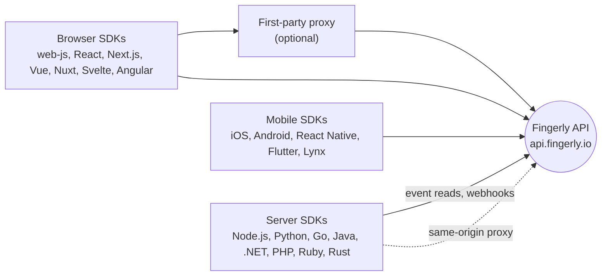

<p align="center">
  <a href="https://fingerly.io">
    <picture>
      <source media="(prefers-color-scheme: dark)" srcset="https://raw.githubusercontent.com/fingerly-io/.github/main/assets/logo-dark.svg">
      
    </picture>
  </a>
</p>

<p align="center"><b>Fingerly SDKs</b><br>Browser, mobile and server SDKs and first-party proxies for protecting signups, logins and payments from fraud and abuse.</p>

<p align="center">
  <a href="https://github.com/fingerly-io/sdks/actions/workflows/release.yml"></a>
  <a href="LICENSE"></a>
  <a href="https://docs.fingerly.io/docs/sdks"></a>
</p>

<p align="center"></p>

## What is this

[Fingerly](https://fingerly.io) is device intelligence for fraud prevention: it recognises returning
devices and returns fraud signals, so you can protect signups, logins and payments. This
repository is the home of the Fingerly SDKs. It is the integration workspace (a pnpm workspace
driven by Turborepo) for the browser SDK and its framework bindings, and it mounts the mobile
SDKs, the server SDKs and the Cloudflare Worker proxy as git submodules, each of them an
independently versioned repository.

Pick the SDK for your platform below. Each one has its own README and a page on
[docs.fingerly.io](https://docs.fingerly.io/docs/sdks).

- [Pick your SDK](#pick-your-sdk)
- [Getting started](#getting-started)
- [How the pieces fit](#how-the-pieces-fit)
- [Repository layout](#repository-layout)
- [Development](#development)
- [Privacy and consent](#privacy-and-consent)
- [Documentation](#documentation)
- [Help](#help)
- [Licence](#licence)

## Pick your SDK

Every SDK submits to `https://api.fingerly.io`. The optional `endpoint`/`endpoints` setting
always wins, which is how a customer uses the Fingerly same-origin proxy on their own domain.

### Web

Browser SDK and framework bindings. All of them are Apache-2.0 and live in folders of this
repository, except `@fingerly/types`, which is a submodule.

| SDK | Package | Version | Source | Docs |
| --- | --- | --- | --- | --- |
| Browser (vanilla JavaScript) | [`@fingerly/web-js`](https://www.npmjs.com/package/@fingerly/web-js) |  | [`client/web/web-js`](client/web/web-js) | [JavaScript](https://docs.fingerly.io/docs/sdks/javascript) |
| Core (shared by the browser SDKs) | [`@fingerly/core`](https://www.npmjs.com/package/@fingerly/core) |  | [`client/web/core`](client/web/core) | [README](client/web/core/README.md) |
| React | [`@fingerly/react`](https://www.npmjs.com/package/@fingerly/react) |  | [`client/web/react`](client/web/react) | [React](https://docs.fingerly.io/docs/sdks/react) |
| Next.js | [`@fingerly/next`](https://www.npmjs.com/package/@fingerly/next) |  | [`client/web/next`](client/web/next) | [Next.js](https://docs.fingerly.io/docs/sdks/nextjs) |
| Vue | [`@fingerly/vue`](https://www.npmjs.com/package/@fingerly/vue) |  | [`client/web/vue`](client/web/vue) | [Vue](https://docs.fingerly.io/docs/sdks/vue) |
| Nuxt | [`@fingerly/nuxt`](https://www.npmjs.com/package/@fingerly/nuxt) |  | [`client/web/nuxt`](client/web/nuxt) | [Nuxt](https://docs.fingerly.io/docs/sdks/nuxt) |
| Svelte | [`@fingerly/svelte`](https://www.npmjs.com/package/@fingerly/svelte) |  | [`client/web/svelte`](client/web/svelte) | [Svelte](https://docs.fingerly.io/docs/sdks/svelte) |
| Angular | [`@fingerly/angular`](https://www.npmjs.com/package/@fingerly/angular) |  | [`client/web/angular`](client/web/angular) | [Angular](https://docs.fingerly.io/docs/sdks/angular) |
| Shared TypeScript types | [`@fingerly/types`](https://www.npmjs.com/package/@fingerly/types) |  | [`sdk-types`](https://github.com/fingerly-io/sdk-types) | [README](https://github.com/fingerly-io/sdk-types#readme) |

The browser SDK is not for apps. Do not embed `@fingerly/web-js` or a framework binding in an
app's web view; use a mobile SDK below ([why](#privacy-and-consent)).

### Mobile

| SDK | Package | Version | Repository | Docs |
| --- | --- | --- | --- | --- |
| iOS (Swift) | Swift package [`sdk-ios`](https://github.com/fingerly-io/sdk-ios) |  | [`sdk-ios`](https://github.com/fingerly-io/sdk-ios) | [iOS](https://docs.fingerly.io/docs/sdks/ios) |
| Android (Kotlin) | `io.fingerly:fingerly` from `https://maven.fingerly.io` |  | [`sdk-android`](https://github.com/fingerly-io/sdk-android) | [Android](https://docs.fingerly.io/docs/sdks/android) |
| React Native | [`@fingerly/react-native`](https://www.npmjs.com/package/@fingerly/react-native) |  | [`sdk-react-native`](https://github.com/fingerly-io/sdk-react-native) | [React Native](https://docs.fingerly.io/docs/sdks/react-native) |
| Flutter | [`fingerly_flutter`](https://pub.dev/packages/fingerly_flutter) |  | [`sdk-flutter`](https://github.com/fingerly-io/sdk-flutter) | [Flutter](https://docs.fingerly.io/docs/sdks/flutter) |
| Lynx | [`@fingerly/lynx`](https://www.npmjs.com/package/@fingerly/lynx) |  | [`sdk-lynx`](https://github.com/fingerly-io/sdk-lynx) | [Lynx](https://docs.fingerly.io/docs/sdks/lynx) |

The native iOS and Android SDKs are closed binaries under the Fingerly SDK License. The public
`sdk-ios` and `sdk-android` repositories hold the install notes and the licence, not source. The
React Native, Flutter and Lynx bridges are open source under Apache-2.0.

### Server

Each server SDK reads stored events, verifies webhooks and ships a same-origin proxy. All of them
are Apache-2.0.

| SDK | Package | Version | Repository | Docs |
| --- | --- | --- | --- | --- |
| Node.js | [`@fingerly/node`](https://www.npmjs.com/package/@fingerly/node) |  | [`sdk-node`](https://github.com/fingerly-io/sdk-node) | [Node.js](https://docs.fingerly.io/docs/sdks/node) |
| Python | [`fingerly`](https://pypi.org/project/fingerly/) |  | [`sdk-python`](https://github.com/fingerly-io/sdk-python) | [Python](https://docs.fingerly.io/docs/sdks/python) |
| Go | [`github.com/fingerly-io/fingerly-go`](https://pkg.go.dev/github.com/fingerly-io/fingerly-go) |  | [`fingerly-go`](https://github.com/fingerly-io/fingerly-go) | [Go](https://docs.fingerly.io/docs/sdks/go) |
| Java and JVM | [`io.fingerly:fingerly-server`](https://central.sonatype.com/artifact/io.fingerly/fingerly-server) |  | [`sdk-java`](https://github.com/fingerly-io/sdk-java) | [Java](https://docs.fingerly.io/docs/sdks/java) |
| .NET | [`Fingerly.Server`](https://www.nuget.org/packages/Fingerly.Server) |  | [`sdk-dotnet`](https://github.com/fingerly-io/sdk-dotnet) | [.NET](https://docs.fingerly.io/docs/sdks/dotnet) |
| PHP | [`fingerly/fingerly-php`](https://packagist.org/packages/fingerly/fingerly-php) |  | [`sdk-php`](https://github.com/fingerly-io/sdk-php) | [PHP](https://docs.fingerly.io/docs/sdks/php) |
| Ruby | [`fingerly`](https://rubygems.org/gems/fingerly) |  | [`sdk-ruby`](https://github.com/fingerly-io/sdk-ruby) | [Ruby](https://docs.fingerly.io/docs/sdks/ruby) |
| Rust | [`fingerly`](https://crates.io/crates/fingerly) |  | [`sdk-rust`](https://github.com/fingerly-io/sdk-rust) | [Rust](https://docs.fingerly.io/docs/sdks/rust) |

Two ecosystems publish more than one package. Java also publishes the adapters
`fingerly-server-jakarta`, `fingerly-server-javax` and `fingerly-server-webflux`, all under
`io.fingerly`. .NET also publishes [`Fingerly.Server.AspNetCore`](https://www.nuget.org/packages/Fingerly.Server.AspNetCore).

### Proxies

A first-party proxy serves the browser SDK's submissions from a path on your own site. Create a
proxy in the dashboard, then deploy one of these. The guide is
[Proxy integrations](https://docs.fingerly.io/docs/proxy-integrations).

| Proxy | Version or kind | Source | Docs |
| --- | --- | --- | --- |
| Cloudflare Worker |  | [`proxies/cloudflare`](https://github.com/fingerly-io/cloudflare-worker-proxy) (submodule) | [Cloudflare Worker](https://docs.fingerly.io/docs/sdks/cloudflare-worker) |
| nginx | `nginx/1.0.0` | [`proxies/templates/nginx`](proxies/templates/nginx) | [nginx](https://docs.fingerly.io/docs/proxies/nginx) |
| Caddy | `caddy/1.0.0` | [`proxies/templates/caddy`](proxies/templates/caddy) | [Caddy](https://docs.fingerly.io/docs/proxies/caddy) |
| Vercel | `vercel/1.0.0` | [`proxies/templates/vercel`](proxies/templates/vercel) | [Vercel](https://docs.fingerly.io/docs/proxies/vercel) |
| Netlify | `netlify/1.0.0` | [`proxies/templates/netlify`](proxies/templates/netlify) | [Netlify](https://docs.fingerly.io/docs/proxies/netlify) |
| AWS CloudFront | `aws-cloudfront/1.0.0` | [`proxies/templates/aws-cloudfront`](proxies/templates/aws-cloudfront) | [AWS CloudFront](https://docs.fingerly.io/docs/proxies/aws-cloudfront) |
| Google Cloud Run | `gcp-cloud-run/1.0.0` | [`proxies/templates/gcp-cloud-run`](proxies/templates/gcp-cloud-run) | [Google Cloud Run](https://docs.fingerly.io/docs/proxies/google-cloud-run) |
| Container | `container/1.0.0` | [`proxies/templates/container`](proxies/templates/container) | [Container](https://docs.fingerly.io/docs/proxies/container) |
| Traefik | `container/1.0.0` (it runs the container) | [`proxies/templates/traefik`](proxies/templates/traefik) | [Traefik](https://docs.fingerly.io/docs/proxies/traefik) |

The templates are not published to a registry: copy the files for your platform (see the
[template README](proxies/templates/README.md)). The kind is what each template sends as
`x-fingerly-proxy-version`, which the dashboard shows per proxy.

## Getting started

1. Create a Fingerly project and an SDK key. See [API keys](https://docs.fingerly.io/docs/api-keys)
   and the [quick start](https://docs.fingerly.io/docs/quick-start).
2. Install the SDK for your platform. For the browser:

   ```sh
   npm install @fingerly/web-js
   ```

3. Load it and identify the visitor:

   ```ts
   import { load } from '@fingerly/web-js'

   // Consent defaults to 'pending', which collects and sends nothing. Pass
   // 'granted' only once you have consent (or know none is required for this
   // visitor; see docs/privacy.md §4), or load with the default and call
   // fingerly.setConsent('granted') from your consent tool.
   const fingerly = await load({ apiKey: 'fly_pk_production_…', consent: 'granted' })
   const result = await fingerly.identify({ tag: 'checkout' })
   const { requestId, visitorId, suspectScore, suspectLevel } = result

   // suspectScore and suspectLevel can be null: not scored, or hidden by the key.
   if (suspectLevel === 'high') {
     // an interface hint only: your backend reads the event and decides
   }

   // The authoritative score above never changes. Slower checks continue
   // as an immutable sidecar that applications may observe when useful.
   const deferred = await result.deferred
   ```

`identify()` collects and submits to `POST /api/v1/ingest`, resolving with the server's answer:
`visitorId` and, by default, `suspectScore` and `suspectLevel` come back with the submission.
The score and level are a convenience for trying the product, and a per-key setting hides them,
which looks the same as unscored. Signals are never sent to a browser or an app. Security
decisions belong on your backend, reading the event by request ID, or from webhooks. Pass
`{ submit: false }` to collect without sending anything. Only the raw report comes back then: the
server's fields are empty, and `suspectScore` is `null` rather than `0`, because nobody scored
it.

The default browser run answers within a 300ms initial budget, then continues the slower checks
under a separate 1200ms budget. Their result is archived against the request but never changes
identity, score, billing, or webhooks.

The SDK decides nothing. Every check runs server-side over the stored report, where the rules
can improve without every customer redeploying an SDK. The answer in the page can be edited by
whoever controls it, so decide on your backend from the stored event.

## How the pieces fit



<details>
<summary>One envelope, three platforms</summary>

A browser, an iPhone and an Android phone submit the same report envelope, with the same shape on
every platform. What differs is what each platform can report.

That is what lets the Fingerly API have one reader and one set of rules. The canonical TypeScript
shape lives in `client/web/types/src/index.ts`; `client/web/core` re-exports it, while
`client/mobile/ios/Sources/Fingerly/Core/Types.swift` and `client/mobile/android/.../core/Types.kt`
are literal ports of it, field for field, because both ends were already written.

A native report carries raw measurements only, on the contract in
[`contract/native-report.md`](contract/native-report.md). No client holds a weight, a threshold or
a verdict: the server derives every result from what it received, under the customer's weights,
so a rule can change without an app update. A report claiming a verdict is ignored.

A modified app can still forge raw input, and the server can only score what it receives.
Hardware attestation is what resists that: Android key attestation and iOS App Attest are checked
by the server against the platform vendor's roots, and an event records `attested`,
`not_attested` or `failed`.

</details>

## Repository layout

Folders that are packages in this repository, and folders that are submodules pointing at
separate repositories (see [`.gitmodules`](.gitmodules)):

| Path | What it is | Where it lives |
| --- | --- | --- |
| `client/web/web-js` | Vanilla browser SDK | This repository |
| `client/web/core` | Framework-agnostic client device and event core (TypeScript), shared by the browser SDKs | This repository |
| `client/web/{react,vue,svelte,angular,next,nuxt}` | Framework bindings, built on `web-js`, `vue` and `react` | This repository |
| `client/web/types` | Canonical TypeScript wire contracts (`@fingerly/types`) | Submodule: [`sdk-types`](https://github.com/fingerly-io/sdk-types) |
| `client/mobile/ios` | Native iOS SDK (Swift) | Submodule: `sdk-ios-binary`, a private source repository. Customers use [`sdk-ios`](https://github.com/fingerly-io/sdk-ios) |
| `client/mobile/android` | Native Android SDK (Kotlin) | Submodule: `sdk-android-binary`, a private source repository. Customers use [`sdk-android`](https://github.com/fingerly-io/sdk-android) |
| `client/mobile/react-native` | React Native bridge | Submodule: [`sdk-react-native`](https://github.com/fingerly-io/sdk-react-native) |
| `client/mobile/flutter` | Flutter bridge | Submodule: [`sdk-flutter`](https://github.com/fingerly-io/sdk-flutter) |
| `client/mobile/lynx` | Lynx bridge | Submodule: [`sdk-lynx`](https://github.com/fingerly-io/sdk-lynx) |
| `server/node` | Node.js server SDK | Submodule: [`sdk-node`](https://github.com/fingerly-io/sdk-node) |
| `server/python` | Python server SDK | Submodule: [`sdk-python`](https://github.com/fingerly-io/sdk-python) |
| `server/go` | Go server SDK | Submodule: [`fingerly-go`](https://github.com/fingerly-io/fingerly-go) |
| `server/java` | JVM server SDK | Submodule: [`sdk-java`](https://github.com/fingerly-io/sdk-java) |
| `server/dotnet` | .NET server SDK | Submodule: [`sdk-dotnet`](https://github.com/fingerly-io/sdk-dotnet) |
| `server/ruby` | Ruby server SDK | Submodule: [`sdk-ruby`](https://github.com/fingerly-io/sdk-ruby) |
| `server/rust` | Rust server SDK | Submodule: [`sdk-rust`](https://github.com/fingerly-io/sdk-rust) |
| `server/php` | PHP server SDK | Submodule: [`sdk-php`](https://github.com/fingerly-io/sdk-php) |
| `proxies/cloudflare` | Cloudflare Worker proxy | Submodule: [`cloudflare-worker-proxy`](https://github.com/fingerly-io/cloudflare-worker-proxy), with its own workspace |
| `proxies/templates` | Ready-made proxy templates: private, never published, here for their tests | This repository |
| `contract` | API contract synced from the Fingerly API's OpenAPI spec; the sync point for the API shape across every SDK and panel consumer. Server SDKs vendor snapshots so they can build and test independently | This repository |
| `docs` | Collection notice and browser notes ([`privacy.md`](docs/privacy.md), [`hardened-browsers.md`](docs/hardened-browsers.md), [`private-browsing-matrix.md`](docs/private-browsing-matrix.md)) | This repository |
| `scripts` | Release and pack-check scripts | This repository |

The pnpm workspace ([`pnpm-workspace.yaml`](pnpm-workspace.yaml)) covers `client/web/*`,
`client/mobile/react-native`, `client/mobile/lynx`, `server/*`, `contract` and
`proxies/templates`. Flutter is a Dart and pub package and is not in it. The iOS and Android
SDKs are not driven by Turborepo.

<details>
<summary>What each package is built on</summary>

- `client/web/core`: the framework-agnostic core shared by the browser SDKs. It contains no DOM
  code and is compiled against the worker lib so that it cannot acquire any.
- `client/web/web-js`: the vanilla browser SDK.
- `client/web/vue`: Vue 3 plugin and composables ([README](client/web/vue/README.md)). One shared
  identification per app, readonly reactive state, SSR-safe.
- `client/web/{react,svelte,angular,nuxt,next}`: implemented framework bindings, built on
  `web-js`, `vue` and `react`.
- `client/mobile/ios`: the native iOS SDK. Customers get the compiled framework as the Swift
  package [sdk-ios](https://github.com/fingerly-io/sdk-ios); React Native and Lynx download the
  same XCFramework during `pod install`, while Flutter supports both CocoaPods and Swift Package
  Manager.
- `client/mobile/android`: the native Android SDK. One dependency (coroutines), no JNI, and two
  install-time permissions that prompt nobody. Publishes an AAR as `io.fingerly:fingerly`, which
  is what the three bridges depend on. Both native SDKs are closed binaries under the Fingerly SDK
  License, distributed from `https://maven.fingerly.io` (the Android Maven repository, with the
  iOS artifact under `/ios/`).
- `client/mobile/react-native`, `client/mobile/flutter`, `client/mobile/lynx`: standalone bridges
  to the native SDKs, not second implementations, and open source under Apache-2.0. All three
  are thin on purpose: most of what matters on a phone is only reachable from native code, so the
  bridges call the native SDKs rather than reimplement them. React Native and Lynx are in the pnpm
  workspace; Flutter is a Dart/pub package and is not. Lynx supports Android and iOS hosts.

</details>

<details>
<summary>The server SDKs</summary>

Every server SDK offers stored-event reads, webhook verification and a same-origin proxy,
mirroring the Node SDK's architecture, and each is maintained in its own repository.

- `server/node`: no runtime dependencies.
- `server/python`: a synchronous and an asyncio client over one shared transport, and the proxy is
  served under both ASGI and WSGI, because Python has two server standards where JavaScript has
  one `Request`/`Response`. Python 3.9+, one runtime dependency (`httpx`); uv and ruff for
  tooling.
- `server/go`: named for its import path rather than the `sdk-*` convention, as `stripe-go` is.
  Go 1.22+ and nothing outside the standard library. The proxy is a single `http.Handler`,
  because `net/http` is the one standard every Go router takes, so it needs no adapters.
- `server/java`: Java 11 bytecode built on a 17 toolchain; `jackson-databind` is the only runtime
  dependency. Publishes four artifacts, because Java has three server standards in active use:
  `fingerly-server` plus a `-jakarta`, `-javax` and `-webflux` adapter, each taking its server API
  as `provided`. The WebFlux one offloads the blocking forward off the event loop.
- `server/dotnet`: two packages. `Fingerly.Server` targets net8.0 and netstandard2.0 so the reads
  stay reachable from .NET Framework, and `Fingerly.Server.AspNetCore` mounts the proxy as
  middleware or as routed endpoints. Zero runtime dependencies on net8.0, since `System.Text.Json`
  is in its shared framework; both packages are trimmable and AOT-safe, which is why every type is
  bound through the JSON source generator rather than reflection. Everything is asynchronous, with
  no synchronous counterpart.
- `server/ruby`: Ruby 3.2+ and nothing outside the standard library. The proxy is one piece of
  Rack middleware, because Rack is the interface every Ruby server and framework shares, so it
  needs no adapters. One synchronous client and no asynchronous twin: `Net::HTTP` has honoured the
  fiber scheduler since Ruby 3.0, so the same client is non-blocking under Falcon. Ships RBS
  signatures.
- `server/rust`: Rust 1.88+, async on Tokio, and the only server SDK with no dependency-free
  option: Rust has no HTTP in its standard library, so it is reqwest over rustls. The proxy is a
  `tower::Service` over `http` types rather than a set of framework adapters, because that is the
  interface axum, hyper, warp and tonic already share, the same reasoning that made the Go proxy
  one `http.Handler`. Everything is asynchronous, with no synchronous counterpart; cancellation is
  dropping the future. Webhook verification sits behind no feature, so
  `default-features = false` is a build with neither an HTTP stack nor a runtime in it.
- `server/php`: PHP 8.2+ and nothing outside `ext-curl` and `ext-json`; CI asserts that
  `composer install --no-dev` installs exactly zero packages and that the client, proxy and
  webhook verification all work in that state. A PSR-18 client is accepted but never required,
  because requiring one means the package stops working unless an implementation happens to be
  installed. The proxy is one framework-neutral core plus a PSR-15, a Laravel and a Symfony
  adapter, because PHP has three live server request shapes and no equivalent of Rack to unify
  them, so this is the Java situation rather than the Go one. `handle()` is the interface and the
  adapters are conveniences, so Phalcon, CodeIgniter, Yii or a bare script need about ten lines.

</details>

## Development

Clone and fetch the submodules the JavaScript workspace needs. The native SDK sources are
private, so a full recursive clone only works with access to them:

```
git clone https://github.com/fingerly-io/sdks.git
cd sdks
git submodule update --init -- client/web/types server/node client/mobile/react-native client/mobile/lynx
```

```
pnpm install
pnpm build
pnpm test
pnpm lint

pnpm --filter @fingerly/web-js demo   # http://localhost:4173
```

The root scripts run through Turborepo (`build`, `lint`, `test`, `dev`). `lint` is `tsc --noEmit`
and a package type-checks against its dependencies' built declarations, so Turborepo builds the
dependencies first for both `lint` and `test`.

The iOS SDK is a separate toolchain and is not driven by Turborepo:

```
cd client/mobile/ios
xcodebuild test -scheme Fingerly -destination 'platform=iOS Simulator,name=iPhone 16e'
./Example/run.sh                    # builds, installs and launches on a booted simulator
```

Flutter is a separate Dart package:

```
cd client/mobile/flutter
flutter pub get
flutter analyze
flutter test
```

Lynx is a separate library and example app inside the pnpm workspace:

```
pnpm --dir client/mobile/lynx test
pnpm --dir client/mobile/lynx build
pnpm --dir client/mobile/lynx/example build
```

The demo page runs the browser SDK against whatever browser opens it and renders the whole
report. It submits nothing unless an endpoint and SDK key are filled in. Serve it over
`localhost` rather than opening the file directly: the SDK needs a secure context, and `file://`
is not one.

Install scripts are disabled for every dependency (`.npmrc`); the reason is written out there.

### Releasing the npm packages

Bump the package's `version` and merge to `main`. The Release workflow
([`.github/workflows/release.yml`](.github/workflows/release.yml), steps in
[`scripts/release-npm.mjs`](scripts/release-npm.mjs)) then publishes every npm package whose
version is not on the registry yet, in dependency order, and tags each one with a GitHub Release
named like `@fingerly/core@0.2.0`. A push that changes no version does nothing. Before publishing
it installs from the lockfile, builds, lints, runs the tests and `pnpm check:packs`, then packs
every tarball and inspects it. A manual run can leave packages out with its `exclude` input.

- **Packages from separate repositories.** `@fingerly/node`, `@fingerly/react-native`,
  `@fingerly/lynx` and `@fingerly/types` are published from this repository, from the commit each
  submodule pointer names. Release the commit in the package repository first, then move the
  pointer here in the same change as the version bump.
- **Why the pointer moves with the version.** pnpm packs `workspace:*` dependencies to the exact
  versions of the sibling packages, and the workflow fails if a package needs a sibling version that
  is neither on npm nor in the same release. Pack with pnpm, never plain `npm`: a tarball that still
  says `workspace:*` cannot be installed.
- **React Native and Lynx.** The workflow downloads the iOS zip for the version in
  `ios/fingerly-binary.json` from `maven.fingerly.io` and writes its SHA-256 into the package, so
  `pod install` can refuse any other binary. Upload the iOS binary before releasing them.
- **Locally.** After `pnpm build`, `pnpm check:packs` packs every browser package the way it is
  published and fails on a leftover `workspace:` range, a source map, shipped sources or tests,
  or a missing LICENSE or README. `node scripts/release-npm.mjs constants` checks that the version
  constants in `@fingerly/core` and `@fingerly/node` match their manifests.

## Privacy and consent

[`docs/privacy.md`](docs/privacy.md) is the collection notice for integrators: every signal each
platform reads, what we add server-side, how long it is kept, and what an integrator has to do
about consent.

The part to know: **every SDK's `consent` defaults to `pending`**, which collects and sends
nothing until the integrator calls `setConsent('granted')` (or loads with `granted` once they have
consent, or know none is required for that visitor; see [docs/privacy.md](docs/privacy.md) §4).
Every submission carries `"consent": "granted"`, and the API refuses anything else with
`422 consent_required`.

**The browser SDK is not for apps.** Do not embed `@fingerly/web-js` or a framework binding in an
app's web view (iOS or macOS `WKWebView`, Android `WebView`, Capacitor, Cordova, Ionic, React
Native WebView, Flutter, Electron); use the iOS or Android SDK, or the React Native, Flutter or
Lynx bridge. Inside an app the browser SDK collects nothing and the server matches nothing
([`docs/privacy.md`](docs/privacy.md) §3.3).

### The SDK never asks the visitor for anything

No permission prompt, no picker, no dialog: not on any browser, not for any signal. A fraud check
that interrupts a checkout with a permission dialog has destroyed the thing it was protecting,
and a visitor who is asked has been told they are being measured.

A test in the repository (`client/web/web-js/tests/no-permission-prompts.test.ts`) enforces this
against the source tree, so it cannot regress quietly.

## Documentation

- [SDK overview](https://docs.fingerly.io/docs/sdks) and the [quick start](https://docs.fingerly.io/docs/quick-start)
- [Proxy integrations](https://docs.fingerly.io/docs/proxy-integrations)
- [Privacy and consent](https://docs.fingerly.io/docs/privacy-and-consent)
- [API reference](https://docs.fingerly.io/reference/overview)

## Help

Open an issue on this repository, or write to [support@fingerly.io](mailto:support@fingerly.io).
Report security issues to [security@fingerly.io](mailto:security@fingerly.io).

## Licence

Apache-2.0, see [LICENSE](LICENSE). The native iOS and Android SDK binaries are proprietary, under
the Fingerly SDK License. Fingerly is a product of Badele LLC.
